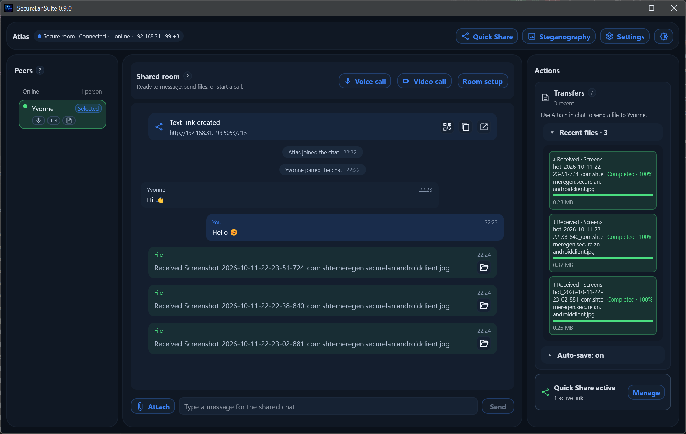
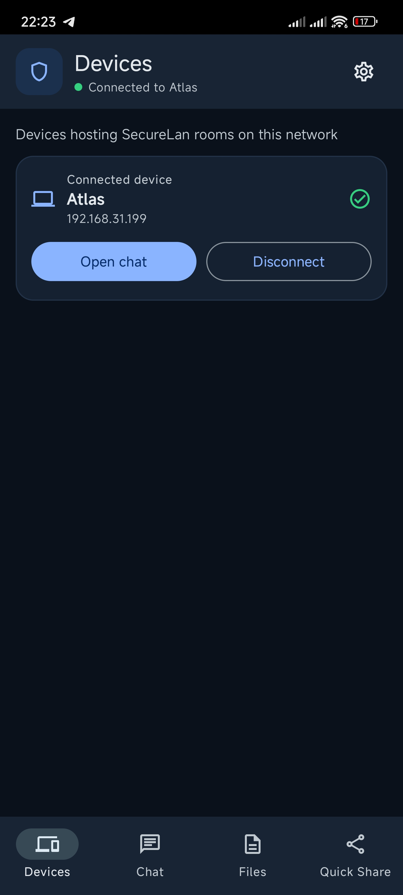
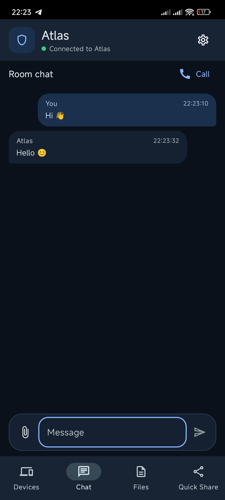
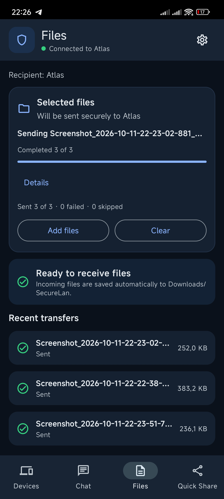

# Secure LAN Suite

Secure LAN Suite is a local-network communication suite for desktop and Android. Devices can discover each other, host or join password-protected rooms, exchange encrypted messages and files, and use experimental realtime media without relying on a cloud service.

The repository is a Gradle multi-module monorepo. The primary desktop client is built with Compose Multiplatform; an experimental Android client provides desktop-compatible LAN interoperability.

## Main features

- Host or join password-protected LAN chat rooms.
- Discover compatible peers with UDP broadcast or connect manually by host and port.
- Exchange encrypted chat messages and files with transfer progress and configurable downloads.
- Select multiple files on Compose desktop or Android, review the recipient and
  send them as a sequential queue with per-file results and explicit retries.
- Create temporary Quick Share browser links for files or text, with expiration and access limits. Quick Share is intended only for trusted LANs because browser transfers use plain local HTTP.
- Use voice sessions and experimental 1-to-1 video calls through WebRTC,
  including microphone, speaker, and camera selection and diagnostics.
- Hide or extract text in BMP images with optional password-based encryption through the desktop Steganography tool.
- Persist desktop profile, appearance, network, media, download, window, and diagnostics settings.
- Build and use the experimental Android client for room hosting/joining, encrypted chat, and file transfer. Android supports adaptive layouts, light/dark themes, and English/Russian/system UI languages.

## Tech stack

- Java 25 for desktop, Java 17 for Android and its shared modules, and Kotlin
- Gradle Wrapper
- Compose Multiplatform for the desktop client
- Jetpack Compose and Android Gradle Plugin for the Android client
- `webrtc-java` for realtime data, voice, and experimental video transport
- `jpackage` and WiX for native application images and Windows EXE installers

## Repository structure

### Applications

- `apps/desktop-client` - Compose desktop client and packaging tasks
- `apps/android-client` - experimental Android client with desktop interoperability

### Core modules

- `modules/common-model` and `modules/common-net` - shared models and networking utilities
- `modules/crypto-core` - encryption, hashing, signatures, key and file-crypto workflows
- `modules/chat-core` - secure rooms, handshake, messaging, signaling, and peer discovery
- `modules/file-transfer-core` - encrypted file transfer and Quick Share services
- `modules/webrtc-core`, `modules/audio-core`, and `modules/webcam-core` - realtime sessions and media profiles
- `modules/stego-core` - UI-independent BMP steganography services

## Screenshots

### Desktop

### Android

  
  
  

## Documentation

- Shared instructions for Kilo, Codex, Antigravity, and other coding agents: [`AGENTS.md`](AGENTS.md)
- Desktop product and UX guidance: [`docs/product-ui.md`](docs/product-ui.md)
- UI quality checklists: [`docs/quality/`](docs/quality/)
- Development, build, run, and smoke-test guide: [`docs/development.md`](docs/development.md)
- Android build, signing, and installation: [`apps/android-client/android-readme.md`](apps/android-client/android-readme.md)
- Windows WiX installation: [`docs/wix-installation.md`](docs/wix-installation.md)
- WebRTC architecture and video-preview properties: [`docs/webrtc-architecture.md`](docs/webrtc-architecture.md)
- Active outcomes and release work: [`docs/roadmap.md`](docs/roadmap.md)
- Completed legacy consolidation: [`docs/migration-history.md`](docs/migration-history.md)

## Current limitations

- LAN discovery uses UDP broadcast and may require additional hardening for complex networks, firewalls, VPNs, and multi-adapter setups.
- Key management and advanced file-transfer controls are not fully exposed in the desktop UI.
- File batches are local sender queues of independent encrypted transfers, not
  atomic deliveries. Receiver approval remains per file. Stopping a batch waits
  for its current file; missing final confirmation can mean the file was saved,
  so retrying can create a duplicate. Queues are not restored after app restart,
  and Android background execution is not guaranteed.
- Voice/video behavior and device selection still need broader cross-device validation; video calls and preview remain experimental.
- Desktop steganography exposes text workflows for uncompressed 24-bit/32-bit BMP images. Binary payloads are supported by the core API but not by the UI.
- Android remains an experimental interoperability client and does not yet support voice, WebRTC data channels, camera/video, steganography, screen sharing, or Quick Share.
- Large file transfer over `RTCDataChannel` and screen sharing are not implemented.
- Windows EXE packaging is Windows-only because `jpackage` does not cross-build Windows installers.
