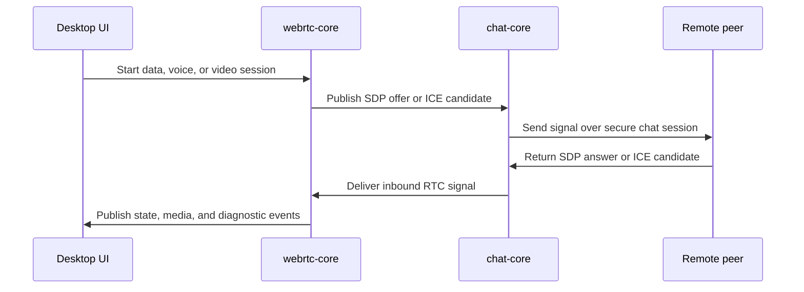

# WebRTC Architecture in SecureLanSuite

This document describes the realtime layer built on the secure chat, discovery,
and file-transfer stack.

## Ownership

- `chat-core` transports realtime signaling envelopes over an established
  secure chat connection.
- `webrtc-core` owns session orchestration and state, signaling handlers,
  diagnostics, media-device discovery, camera preview, and native
  `webrtc-java` integration.
- `audio-core` and `webcam-core` contain standalone profile DTOs/default services,
  with no runtime dependencies. Active capture does not call those services;
  `VideoCapabilitySelector` selects supported camera modes inside `webrtc-core`.
- `desktop-client` owns call controls, media settings, video presentation, and
  conversion of runtime events into UI state.

## Supported flows

Primary flows:

- RTC data-channel sessions;
- voice sessions backed by native `webrtc-java`;
- SDP and ICE signaling over secure chat;
- microphone, speaker, and camera enumeration and selection;
- microphone and speaker tests;
- realtime state and diagnostic events.

Implemented experimental flows:

- camera preview;
- one-to-one video calls and inline video stage;
- local and remote frame propagation;
- preview conversion guards and failure diagnostics.

Video remains experimental until capture, preview, remote rendering, and
device/runtime compatibility have broader validation.

## Runtime behavior

`RtcSessionService` creates an `RtcEngine` through `RtcEngineProvider`. Startup
tries the native engine and falls back to `NoOpRtcEngine` when initialization
fails.

`WebRtcJavaEngine` provides:

- offer/answer negotiation and trickle ICE over `chat-core`;
- automatic data-channel creation for local outbound sessions;
- microphone capture and playout through `AudioDeviceModule`;
- local and remote audio-level events;
- camera capture through `MediaDevices`, `VideoDeviceSource`, and `VideoTrack`;
- selected capture-device IDs for sessions;
- remote audio/video track observation;
- diagnostic events and video preview conversion guards.

## Desktop experience

The desktop experience is chat-first and voice-first. A user selects a peer,
keeps the conversation available, and starts voice or experimental video from
the conversation header or contextual actions.

`LiveActionsColumn` builds the right context area from the current selection and
activity. It shows relevant call or transfer summaries and Quick Share activity;
it is not a permanent inventory of media controls, RTC tools, or diagnostics.
At narrow widths the same context moves into a drawer.

Microphone, speaker, camera, and preview controls live in **Settings → Audio &
Video**. The settings UI enumerates input and output devices, persists the
selected speaker through `media.outputDeviceId`, and supports microphone,
speaker, and camera tests. If no device is selected, the runtime uses an
available default.

Diagnostics primarily go to logs. Runtime failures may be summarized in the
affected call or settings flow, but no standalone Diagnostics screen is
required.

### Video preview flags

The desktop client reads these JVM system properties:

- `securelan.rtc.videoPreview.local.enabled`
- `securelan.rtc.videoPreview.remote.enabled`

Both are enabled by default. They can be disabled while investigating capture
or frame-conversion problems.

## Signaling flow

Signaling travels over the V2 password-authenticated chat record channel. The room
host can read SDP/ICE; this is not end-to-end encrypted signaling. See the
[security protocol](security-protocol.md) for its trust boundaries.

Desktop incoming offers wait for an explicit Accept/Decline decision before native
session creation or microphone/camera capture. The incoming dialog identifies the
requested media, and dismissal declines. Setup times out after 30 seconds; busy,
foreign, unexpected and retired-session signals cannot replace the active call.
Disconnect, host stop and peer departure close realtime resources. Native audio
recording/playout stops after the last session releases its device lease.

## Diagnostic coverage

The runtime reports native provider initialization, signaling and ICE progress,
selected and default devices, audio levels, video frames, preview conversion,
camera preview state, warnings, and failures. Logs must not contain room secrets,
private keys, passwords, or raw sensitive payloads.

## Current constraints and next work

- Video can fail on some Windows, JDK, camera, or driver combinations.
- The video experience is one-to-one rather than a conference grid.
- Chunked large-file transfer over `RTCDataChannel` is not implemented.
- Screen sharing is not implemented.
- Video needs broader cross-machine and cross-device validation before it can be
  presented as stable.
- Preview and capture flags may move from JVM properties to explicit
  experimental settings when that flow is designed.

## Application and native boundaries

The supported desktop surface is `RtcSessionService`, `RtcMediaDeviceService`,
`RtcEngine`, runtime status and events. `runtime.video` classes are implementation
helpers, including Java-public helpers needed across runtime packages. The vendor
SDK is an implementation dependency and remains on the desktop runtime classpath.
Media preview and service `close()` initiate cleanup without detecting AWT or
waiting for native disposal. Shutdown/tests may explicitly call
`awaitClosed(timeoutMillis)` off the UI thread.

Desktop `DesktopMediaController` owns preview handles/generations; frame delivery
retains only the latest frame with one pending UI task per stream. Room, tool and
media owners feed the existing adapter facade, whose state transitions run on EDT.

Android `MainViewModelFactory` constructs an injected per-workspace graph.
`AndroidCallSession` owns media, audio routing, incoming notifications and the
foreground call request callbacks. UI observes `CallUiState` and actions. Rotation,
Home and PiP retain the ViewModel owner; finishing its Activity clears the owner,
ends its call and stops foreground call work. Background survival after Activity
finish is not a supported policy. The room host service has its own lifecycle.
Physical-device rotation/PiP/finish checks remain separate from JVM tests.

Android signaling admits at most 64 queued signals and one in-flight write.
Retiring a call cancels its pending/in-flight negotiation traffic. Busy/unsupported
replies are rate limited separately; a final HANGUP is retained as terminal traffic
with a one-second send budget and an observable failure message. OFFER remains
ordered before that session's ICE. This local policy does not add a wire ACK.

## Media configuration and lifecycle

The desktop adapter supplies one `RtcMediaConfiguration` (microphone, speaker,
camera) before an outgoing call or explicit incoming acceptance. The RTC worker
creates/recreates its engine with that configuration between calls. Changes during
an active call apply to the next call; they do not restart capture. An explicit
unavailable device produces a warning and disables the corresponding local media
instead of silently selecting a different device. Empty selections use OS defaults.
A fallback engine is retried on the next accepted/outgoing call.

Device enumeration/tests run through bounded desktop background work with a
10-second result deadline and generation checks. Driver calls can outlive that
deadline; late results are discarded and shutdown does not wait on JNI. Preview
rotation/raster conversion runs outside composition and uses raw BGRA raster copies
instead of PNG compression/decompression.

Peer operations and native signaling observers run on one engine worker. Observers
enqueue their work and return immediately: JNI can wait for its signaling thread,
so holding a Java monitor across SDP/ICE calls can deadlock remote-track delivery
and prevent queued camera cleanup. Application calls wait for the engine worker
off the UI thread. Media frames keep their existing delivery path.

Peer close invalidates queued callbacks before detaching observers and sinks.
Local senders detach before PeerConnection.close; owned tracks and data channels
then release their JNI references. Pending channel handoffs are also released.
Remote tracks are borrowed and are not disposed by the application. Failed
factory/peer construction rolls back acquired resources. SDP readiness and pending
ICE enqueue/drain share the worker, including the existing 256-candidate limit.

Local HANGUP publishes closing/closed state and schedules native cleanup immediately;
signaling uses a separate bounded serial outbox and never holds the service monitor
while writing to chat. Hardware timing and native memory behavior still require the
physical-device checks described above.

The `:modules:webrtc-core:nativeVideoSmoke` task checks real JNI negotiation,
synthetic remote video, outgoing data and teardown in a separate process with a
deadline. `-PrtcSmokeCamera=true` also exercises two outgoing video calls with the
local camera to check remote/local frames and reopening after cleanup. It does
not replace desktop/Android testing on two physical devices.
